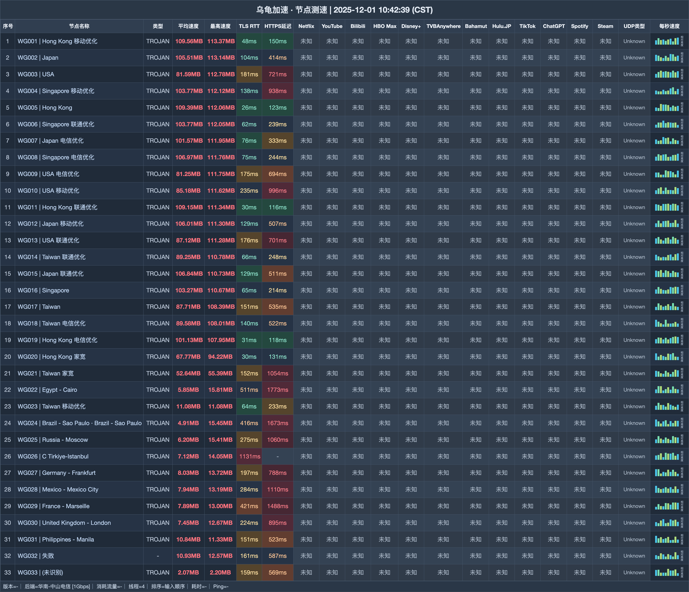

# 乌龟加速机场｜18 元/月 200G，月付档家庭不限设备（2026-11-04 更新）

> **一句话评价：性价比家庭之选：18 元 200G 起，四档月付覆盖 200G—1200G**
>
> 👉 **[官网注册](https://wuguijiasu.com/#/login?code=dd6NtGYo)** · 先用 18 元 Mini；多人看视频可选 38 元 Pro。

**适合：**

- 希望低价获得 200G 起步流量
- 家庭成员多、设备多
- 愿意使用官方专属客户端并先核对支持系统

**不适合：**

- 只想使用非官方客户端
- 完全不需要 EMBY 或家庭共享

| | |
|---|---|
| 起步价 | 18 元/月 200G |
| 月付流量 | 200G—1200G |
| 限速 |  300—1000Mbps |
| 设备 | 月付档不限，限家庭共享；6000G 档容量字段存在两种记录 |
| 线路 |  IEPL |
| 客户端 | 须用官方专属客户端；支持系统未提供 |

**关于乌龟加速**：乌龟加速（wuguijiasu）走 IEPL 线路，月付 18 元/200G 起；须用官方专属客户端，6000G 档容量待确认。

## 套餐

| 套餐 | 价格 | 流量 | 设备 | 限速 | 说明 |
|---|---:|---:|---:|---:|---|
| Mini-包月200G | ¥18/月付 | 200G · 每月 | 不限 | 300M | 可购买重置包；家庭共享；赠送EMBY |
| Pro-包月500G | ¥38/月付 | 500G · 每月 | 不限 | 500M | 可购买重置包；家庭共享；赠送EMBY |
| Max-包月800G | ¥58/月付 | 800G · 每月 | 不限 | 800M | 可购买重置包；家庭共享；赠送EMBY |
| Star-包月1200G | ¥78/月付 | 1200G · 每月 | 不限 | 1000M | 可购买重置包；家庭共享；赠送EMBY |
| Max-不限时3000G | ¥358/一次性 | 3000G · 用完为止 | 不限 | 1000M | 可购买重置包；家庭共享 |
| Star-不限时6000G | ¥658/一次性 | 容量待确认 · 用完为止 | 不限 | 1000M | 标题/括注6000G/6000GB；详情字段658.00GB，与¥658价格疑似串位但未证实 |

> 须用官方专属客户端；支持系统及非官方客户端兼容性未提供。无退款。6000G 档标题/括注写 6000G/6000GB，详情字段却写 658.00GB，容量待确认；¥658 价格照录，不以 6000G 作确定推荐。

## 测速参考

共 33 个节点（下载/延迟），测试端 华南-中山电信 [1Gbps]，完整记录见下图与 `data/`。

## 怎么选

- 18 元 Mini 是 200G 档， 300Mbps；先确认官方客户端支持系统与来源。
- 需要 500G 可比较 38 元 Pro， 500Mbps；套餐限速不是本站测速结果。
- 大流量用户可看 358 元 3000G 不限时包；6000G 档容量字段冲突，不纳入容量推荐。

## 注册

👉 **[官网注册](https://wuguijiasu.com/#/login?code=dd6NtGYo)** · 先用 18 元 Mini；多人看视频可选 38 元 Pro。

*本文使用推广链接，注册或购买后本站可能获得佣金。*

## 更新

- **2026-11-04** — 每日复核：套餐、价格与公告无变化；多账号发布对齐核查完成。
- **2026-11-02** — 每日复核：套餐、价格与公告无变化；多账号发布对齐核查完成。
- **2026-10-31** — 整理当前套餐资料，共 6 个套餐/展示项；加入节点测速参考。
- **2025-12-02** — 节点测速记录日期。

---
*价格、节点和活动会变化，下单时以套餐页显示为准。*

---

相关搜索：乌龟加速 / wugui / 机场推荐

本文关键词：乌龟加速、乌龟、wugui、乌龟机场、wuguijiasu、机场推荐、机场测评、机场推荐2026、科学上网、代理、VPN、clash 订阅、乌龟加速官网、乌龟加速注册、乌龟加速测速

